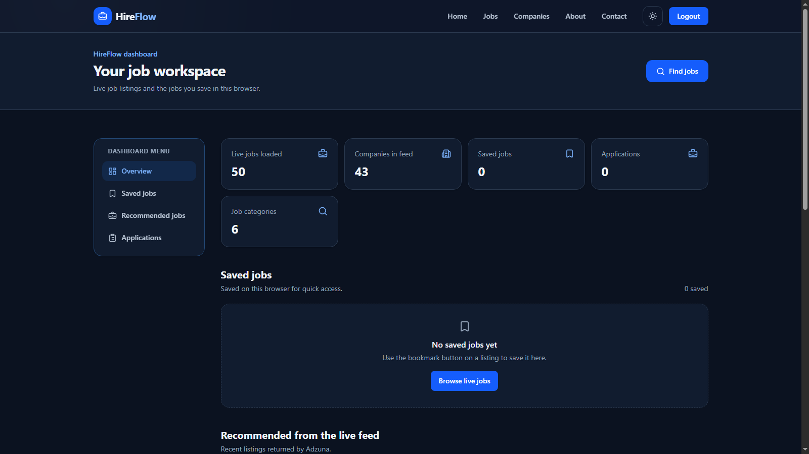
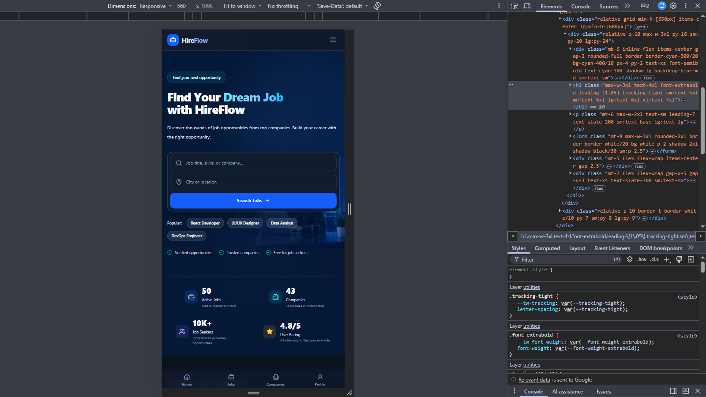

# HireFlow Job Hub

HireFlow Job Hub is a modern, fully responsive **frontend job discovery web application** built with React, Tailwind CSS, and the Adzuna Jobs API. It provides an interactive user interface for exploring job opportunities, discovering companies, saving jobs, and tracking job applications.

## Live Demo

[View HireFlow Job Hub](https://hireflow-job-hub.vercel.app)

## 📸 Screenshots

### Home Page


### Job Filter & Listing


### Dashboard UI



### Responsive Design



## Features

- Fully responsive job portal UI for desktop, tablet, and mobile
- Frontend authentication UI with Login and Sign Up screens (no real server-side authentication)
- Live job search with keyword and location filters
- Job filtering by category, job type, experience level, and salary
- Company discovery and browsing
- Save and manage favorite job opportunities
- Dashboard for managing saved jobs and applications
- Application preparation and tracking
- Client-side account and role-based UI demonstrations
- Light and dark theme support
- Local browser storage for user preferences, saved jobs, and application data

## Tech Stack

- React
- React Router
- Vite
- Tailwind CSS
- Adzuna Jobs API
- LocalStorage
  
## Project Structure

```text
hireflow-job-hub/
├── api/
│   ├── adzuna/
│   │   └── [...path].js
│   ├── adzuna.js
│   └── adzunaProxy.js
├── public/
│   └── favicon.svg
├── src/
│   ├── assets/
│   │   ├── screenshots/
│   │   ├── career-cta.jpg
│   │   └── hireflow-hero.jpg
│   ├── components/
│   │   ├── common/
│   │   ├── companies/
│   │   ├── dashboard/
│   │   ├── home/
│   │   ├── jobs/
│   │   └── layout/
│   ├── context/
│   │   ├── theme/
│   │   └── toast/
│   ├── layouts/
│   ├── pages/
│   ├── routes/
│   ├── services/
│   ├── App.jsx
│   ├── index.css
│   └── main.jsx
├── eslint.config.js
├── index.html
├── package.json
├── vite.config.js
└── vercel.json
```

## Local Development

1. Clone the repository:

git clone https://github.com/syedfurqanullah/hireflow-job-hub.git
cd hireflow-job-hub

2. Install dependencies:

npm install

3. Start the development server:

npm run dev

4. Open the local URL shown in your terminal.

## Notes

HireFlow Job Hub is a **frontend-focused React project** built to strengthen my skills in React, API integration, responsive UI development, state management, and interactive user experiences.

This project focuses on the frontend only. User account screens are UI demonstrations; saved jobs, applications, and preferences are stored in the browser using LocalStorage. It does **not** include a backend database or real server-side authentication.

## Author

- **Portfolio:** [Syed Furqan Ullah](https://syedfurqanullah.netlify.app/)
- **GitHub:** [@syedfurqanullah](https://github.com/syedfurqanullah)
- **LinkedIn:** [Syed Furqan Ullah](https://www.linkedin.com/in/syed-furqan-ullah/)
